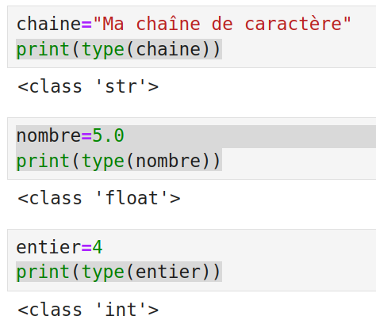

<!-- _class: titre -->
<!-- _paginate: skip -->
<!-- _footer: "" -->

###### Cours

# Les patrons **de conception**

novembre 2026

Mickaël Borne

---

<!-- _class: colonnes -->

## Plan

<div class="col">

1. [Introduction](#introduction)
2. [La programmation orientée objet (POO)](#la-programmation-orientée-objet-poo)
3. [Les principes de conception](#les-principes-de-conception)
4. [Les anti-patrons](#les-anti-patrons)
5. [Les patrons de conception](#les-patrons-de-conception-1)

</div>
<div class="col">

6. [Les patrons architecturaux](#les-patrons-architecturaux)
7. [Conclusion](#conclusion)

[Annexes et références](https://mborne.github.io/architecture/patrons-conception/)

</div>

---

<!-- _class: chapitre -->
<!-- _paginate: hold -->

###### 01

# **Introduction**

---

<!-- header: Introduction -->

## Pourquoi faire des efforts de conception ?

Il faut avoir en tête **la seule constante du développement : le changement !**

De nombreux événements conduiront à modifier le code d'une application :

- Modification des fonctionnalités et modèles
- Augmentation du nombre d'utilisateurs et des volumes de données
- Obsolescence des outils (bibliothèques, frameworks, services tiers…)
- Changement de cible (desktop, serveur, mobile, cloud…)
- Choix politique (base de données, OpenSource…)

---

<!-- _class: violet -->

> **Sans effort de conception**, plus le temps passera, plus il sera **difficile, coûteux et risqué** de traiter ces changements.

---

<!-- _class: dense -->

## Quels sont les critères qualités d'un programme ?

Il conviendra de **cibler plusieurs critères qualités qui guideront la conception** :

- **Fiabilité** : faire tourner le programme sans risque de plantage
- **Maintenabilité** : corriger facilement un bug, mettre à jour les dépendances…
- **Performance** : minimiser le temps d'exécution, la consommation de RAM, de stockage…
- **Évolutivité** : ajouter facilement des fonctionnalités sans risque de régression
- **Réutilisabilité** : réutiliser un code dans un autre contexte
- **Portabilité** : porter facilement un programme d'une cible vers une autre
- **Testabilité** : écrire facilement des tests unitaires et fonctionnels

Nous serons souvent amenés à **prioriser ces critères** (ex : privilégier les performances plutôt que la généricité).

---

## Les patrons de conception dans tout ça ?

Ce cours s'inspire de **« Design patterns : tête la première »** d'Eric Freeman et Kathy Sierra. Nous verrons :

- Les **prérequis** pour **comprendre l'intérêt des patrons de conception** : La **programmation orientée objet (POO)** et les **principes de conception**
- Les **mauvaises pratiques** à travers les **anti-patrons**
- Les **bonnes pratiques** avec les principaux **patrons de conception** (TP)
- Quelques **patrons architecturaux**

---

<!-- _class: chapitre -->
<!-- _paginate: hold -->
<!-- header: "" -->

###### 02

# La programmation **orientée objet (POO)**

---

<!-- header: La programmation orientée objet (POO) -->

## Un paradigme omniprésent

De nombreux programmeurs manipulent des objets sans forcément en avoir conscience :

- En appelant `chaine.upper()` pour transformer une chaîne de caractères en majuscules, nous faisons appel à la **notation pointée** typique de la POO
- En Python, tout est objet :

<div class="center">
    
</div>

---

## Un paradigme difficile à maîtriser

**Utiliser des classes existantes ne demandera pas d'effort**. Il sera plus délicat de :

- **Concevoir proprement <u>ses propres classes</u>**
- **Choisir entre la définition d'une classe et un autre paradigme** (ex : une fonction) quand le langage le permet

Nous nous concentrerons sur la POO en mentionnant la **possibilité de mixer les paradigmes** :

```js
const nombreUtilisateursMajeurs = userRepo.getUsers()
  .filter(user => user.age >= 18) // programmation fonctionnelle + POO
  .count()
;
```

---

<!-- _class: colonnes -->

## Les concepts de base

Les concepts suivants sont normalement connus avant de débuter ce cours :

<div class="col">

- Les **classes** avec leurs **attributs** et leurs **méthodes**
- Les **constructeurs**
- Les **objets**
- La **visibilité** (public, private, protected)
- Les **accesseurs** (get, set, add, remove…)
- Les **relations** (composition, agrégation)

</div>
<div class="col">

- L'**héritage** et le **polymorphisme**
- Les **méthodes et classes abstraites**
- Les **interfaces**
- Les **méthodes statiques**
- Les **attributs statiques**

</div>

---

## Bien comprendre l'intérêt de ces concepts !

Les **concepts de classe, d'attribut et l'héritage sont généralement bien maîtrisés pour modéliser des données** (objet de domaine).

Il convient toutefois de **bien comprendre l'intérêt des autres concepts de la POO** pour **modéliser des traitements** :

- Se protéger contre des erreurs de programmation
- S'assurer d'être en mesure de modifier le code sans casser les appels
- Pouvoir tester unitairement les fonctionnalités (en bouchonnant les autres à l'aide de « mock »)

→ [Méditons quelques exemples](poo.md)

---

## Une conception à adapter au langage

Les langages qui permettent de définir et manipuler les concepts de base de la POO sont nombreux (Java, JavaScript (ES6), TypeScript, C++, Python, PHP, Go, Rust…).

Nous traiterons ce cours avec des exemples et TP en TypeScript en nous concentrant sur ce qui est applicable à de nombreux langages.

Nous noterons toutefois que **[les langages ont des spécificités](https://mborne.github.io/architecture/patrons-conception/specificites-langages/) qui devront être prises en compte et exploitées dans la conception**.

---

<!-- _class: chapitre -->
<!-- _paginate: hold -->
<!-- header: "" -->

###### 03

# Les principes **de conception**

## Des principes qui s'ajoutent aux principes de base de la POO (abstraction, encapsulation…)

---

<!-- header: Les principes de conception -->

## SOLID

Nous allons commencer par **5 principes fondamentaux** regroupés dans l'acronyme **SOLID** :

- **S**ingle Responsibility Principle (SRP, **responsabilité unique**)
- **O**pen Closed Principle (OCP, **ouvert/fermé**)
- **L**iskov Substitution Principle (LSP, **substitution de Liskov**)
- **I**nterface Segregation Principle (ISP, **ségrégation des interfaces**)
- **D**ependency Inversion Principle (DIP, **inversion des dépendances**)

---

<!-- _class: colonnes -->

## (S)ingle Responsibility Principle

**Une classe remplit une fonction et une seule.**

<div class="col eviter">

#### À éviter

Cette classe permet la lecture des communes à partir d'un fichier [ADMINEXPRESS](https://geoservices.ign.fr/adminexpress) et le calcul des statistiques sur les communes.

</div>
<div class="col privilegier">

#### À privilégier

- Cette classe permet le calcul des statistiques sur une liste de communes
- Cette classe lit les communes à partir d'un fichier [ADMINEXPRESS](https://geoservices.ign.fr/adminexpress)

</div>

---

<!-- _class: colonnes -->

## (O)pen Closed Principle

**Une classe doit être ouverte à l'extension, mais fermée aux modifications.**

<div class="col eviter">

#### À éviter

Pour modifier le comportement d'une classe existante, je modifie son code.

</div>
<div class="col privilegier">

#### À privilégier

Pour modifier le comportement d'une classe, je peux en hériter et surcharger une ou plusieurs méthodes.

</div>

---

<!-- _class: colonnes dense -->

## (L)iskov Substitution Principle

**Lorsqu'une classe se substitue à une autre, le programme continue de fonctionner.**

<div class="col eviter">

#### À éviter

Cas 1 : j'ajoute une classe à une hiérarchie, je lance une exception « cette méthode n'est pas implémentée » sur une méthode.

Cas 2 : j'ajoute une classe à une hiérarchie, je provoque le lancement d'exception « cette méthode n'est pas implémentée pour ce type » dans d'autres parties du code.

</div>
<div class="col privilegier">

#### À privilégier

Avant d'hériter d'une classe, je m'assure que je pourrai implémenter toutes les méthodes et que ça ne posera pas de problème dans le reste du code.

</div>

---

<!-- _class: colonnes -->

## (I)nterface Segregation Principle

**Préférer plusieurs interfaces spécifiques plutôt qu'une seule interface générale.**

<div class="col eviter">

#### À éviter

Je définis une interface `Client` avec des méthodes pour faire des requêtes HTTP (`httpGet`, `httpPost`…), télécharger des fichiers FTP (`ftpGet`), envoyer des mails (`sendMail`)…

</div>
<div class="col privilegier">

#### À privilégier

Je définis une interface pour chaque protocole : `HttpClient`, `FtpClient`, `Mailer`.

</div>

---

<!-- _class: colonnes -->

## (D)ependency Inversion Principle

**Il faut dépendre des interfaces, pas des implémentations (classes concrètes).**

<div class="col eviter">

#### À éviter

Je référence des classes concrètes dans les déclarations des constructeurs et des méthodes :

- `GpsLocationProvider`
- `GeoplateformeGeocoder`

</div>
<div class="col privilegier">

#### À privilégier

Je référence des interfaces dans les déclarations :

- `LocationProvider`
- `Geocoder`

</div>

---

<!-- _class: colonnes -->

## DRY : Don't Repeat Yourself

**Il convient d'éviter les répétitions de code.**

<div class="col eviter">

#### À éviter

Pour réutiliser un code, je le copie/colle dans ma méthode.

</div>
<div class="col privilegier">

#### À privilégier

Pour réutiliser un code, je le **mets en facteur** dans une méthode ou une classe que j'utilise à plusieurs endroits.

</div>

---

<!-- _class: colonnes dense -->

## YAGNI : You Ain't Gonna Need It

**Il convient de coder uniquement ce qui est utile, de ne pas ajouter du code en se disant que ça servira un jour.**

<div class="col eviter">

#### À éviter

- Je produis mes résultats dans de nombreux formats (shapefile, CSV, JSON, GeoJSON, GML…)
- Je supporte la 2D et la 3D car certaines de mes sources de données sont en 3D
- Je crée une classe `Batiment` avec tous les attributs BDTOPO

</div>
<div class="col privilegier">

#### À privilégier

- Je produis mes résultats dans un nombre limité de formats demandés par les utilisateurs
- J'ignore la 3D tant que je ne l'utilise pas dans mon application
- Je crée une classe `Batiment` avec les seuls attributs BDTOPO que j'utilise

</div>

---

## Principe d'exposition minimale

Il convient d'**exposer un minimum de fonctionnalités au niveau d'une classe** (i.e. de maximiser l'encapsulation).

En pratique, quand le langage le permet (PHP, Java, C++, TypeScript…) :

- Les **méthodes et attributs sont privés par défaut**
- Les **accesseurs** sont définis **uniquement si c'est nécessaire** (~~`traitement.getLogger()`~~)
- Une **méthode spécifique est préférée à un accesseur permettant de nombreuses opérations**
  - Les **collections sont encapsulées** (~~`obj.points.add(p)`~~ → `obj.addPoint(p)`)

---

## Identifier et encapsuler ce qui varie (1/3)

**Cas d'école** : j'identifie le besoin de **produire des journaux applicatifs (logs) plus ou moins détaillés**…

```ts
class MaClasse {

    faireUnTruc(){
        console.log("Je fais un truc");
        // ...
    }

}
```

---

<!-- _class: dense -->

## Identifier et encapsuler ce qui varie (2/3)

… je fais abstraction sur l'écriture des journaux applicatifs à l'aide d'une classe `Logger` :

```ts
class MaClasse {
    logger: Logger;

    constructor(logger: Logger){
      this.logger = logger;
    }

    faireUnTruc(){
        this.logger.info("Je fais un truc");
    }
}
```

Je peux ainsi configurer le niveau de production des logs au niveau de l'instance `logger`.

---

<!-- _class: dense -->

## Identifier et encapsuler ce qui varie (3/3)

Cette approche est aussi la clé pour **rendre un code unitairement testable** :

```ts
class MonTraitement {
  constructor(private httpClient: HttpClient){}

  async afficheLesCommunes(codePostal: string): void {
    const url = `https://apicarto.ign.fr/api/codes-postaux/communes/${codePostal}`;

    // Non bouchonnable (appel statique) :
    //const data = await fetch(url);
    // Bouchonnable (mock possible sur httpClient) :
    const data = await this.httpClient.get(url);
    console.log(data);
  }
}
```

---

<!-- _class: dense -->

## Préférer la composition à l'héritage (1/2)

- Nous **<u>pourrons</u> hériter d'une classe seulement si nous pouvons dire « EST-UN »** :
  - « Un `Cercle` est une `Forme` »
  - « ~~Un `TraitementMetier` est une `BaseDeDonnees`~~ » → « Un `TraitementMetier` utilise une `BaseDeDonnees` »
- Nous **préférerons les états aux classes dérivées** :
  - Il sera naturel d'**hériter** d'une `Forme` pour modéliser des `Cercle` et des `Rectangle` avec des **attributs spécifiques** (`rayon` vs `largeur` et `hauteur`)
  - Pour une classe `Animal`, nous préférerons l'ajout d'un attribut `type` à la création de classes `Chat` et `Chien` dérivées sans attributs spécifiques

---

## Préférer la composition à l'héritage (2/2)

Pourquoi ? Notez dans un premier temps que :

- L'**héritage** est une **relation plus forte que la composition** (il est donc plus difficile de s'en libérer)
- Si vous développez un formulaire, modifier un `type` (affectation) est plus simple que transformer un `Chien` en `Chat` (construction)

> Spoiler : nous verrons plus tard avec les patrons [Template Method](https://mborne.github.io/architecture/patrons-conception/comportement/TemplateMethod/) et [Strategy](https://mborne.github.io/architecture/patrons-conception/comportement/Strategy/) en quoi la composition est préférable à la surcharge d'une méthode pour faire varier le comportement d'une classe.

---

<!-- _class: chapitre -->
<!-- _paginate: hold -->
<!-- header: "" -->

###### 04

# Les **anti-patrons**

## Mettre un nom sur des erreurs de conception courantes

---

<!-- header: Les anti-patrons -->

## Principe des anti-patrons

- **Nommer** des erreurs de conception classiques
- Faciliter l'identification des erreurs de conception

---

## Réinventer la roue carrée

**Ne pas s'appuyer sur une solution existante.**

Par exemple :

- Développer son propre système pour l'écriture des journaux applicatifs
- Développer son propre système d'exécution de tests unitaires

---

## Programmation spaghetti

**Le rôle des différents éléments du système n'est pas identifiable et il est difficile de savoir qui appelle qui.**

En conséquence, il est difficile de :

- Modifier une partie du code sans en altérer le fonctionnement
- Trouver la cause d'un bug

> Spoiler : nous verrons que les patrons architecturaux amènent un cadre permettant d'éviter ce problème.

---

## Objet divin

L'objet divin porte un **trop grand nombre de responsabilités**.

Il est en **violation flagrante du principe de responsabilité unique (SRP)**.

---

## Abstraction inverse

Un **composant ne fournit pas les abstractions nécessaires**, mais seulement les méthodes les plus compliquées.

**Les abstractions sont développées dans les clients**.

> Spoiler : nous verrons comment le patron façade permet d'y remédier.

---

## Marteau doré

Avec un bon marteau, tous les problèmes sont des clous ! **Un outil est placé comme solution à tous les problèmes.**

<div class="center">
    
    <span class="legende">(Source <a href="http://www.engravingawardsgifts.com/">engravingawardsgifts.com</a>)</span>
</div>

Il peut s'agir d'une bibliothèque, d'une base de données, d'une suite de logiciels, etc.

---

## Coulée de lave

**Un code non finalisé est mis en production. Il n'est plus possible de le remanier.**

Ce problème pourra concerner aussi bien des bibliothèques que des API WEB ou en ligne de commande (CLI). Il conviendra de considérer que **livrer revient à figer les interfaces publiques**.

> Spoiler : il est possible de **traiter les changements en gérant proprement des versions** (voir [mborne.github.io - Le refactoring](https://mborne.github.io/architecture/refactoring/)).

---

<!-- _class: dense -->

## Premature Optimisation (1/2)

**« Premature optimization is the root of all evil » (Donald Knuth)**

- Gaspillage d'énergie pour des gains médiocres (voire négatifs)
- Complexité rendant impossible les optimisations globales
- Complexité mettant en péril la qualité du logiciel (stabilité, maintenabilité, portabilité…)

Exemples :

- Optimiser le parcours séquentiel d'un tableau au point qu'il devient impossible d'exploiter un index spatial
- « Je n'ai pas besoin des arcs entrants pour cet algorithme, je développe une classe dédiée pour ce graphe afin de consommer moins de mémoire ! ». Bilan : le programme réel qui fait appel à plusieurs algorithmes doit faire des copies de graphes.

---

<!-- _class: dense -->

## Premature Optimisation (2/2)

« Premature optimization is the root of all evil » (Donald Knuth) **mais :**

- Il ne faut pas en conclure que l'optimisation doit être ignorée dans la conception !
- Il faut rester prudent sur cette affirmation pour les bibliothèques de bas niveau !
- Parfois, on privilégie la performance à la généricité.

Proposition de méthode :

- **Se concentrer sur les optimisations globales dans la conception** (choix de structures efficaces, indexation, mise en cache…)
- Coder en mettant en place des **tests** et des **mesures de performance** (*bench*)
- **Profiler** et réaliser les **optimisations locales sur les fonctions souvent appelées**

---

<!-- _class: chapitre -->
<!-- _paginate: hold -->
<!-- header: "" -->

###### 05

# Les patrons **de conception**

## Nous y venons enfin ! Alors, les patrons de conception, quésako ?

---

<!-- header: Les patrons de conception -->

## Définition

Le concept de patron de conception a été défini par le **« Gang of Four » (Erich Gamma, Richard Helm, Ralph Johnson et John Vlissides)** dans le livre **« Design Patterns — Elements of Reusable Object-Oriented Software » (1994)**.

Un **patron de conception** est la **description d'une solution réutilisable pour un problème de conception**.

---

## Formalisme des patrons de conception

Ces patrons obéiront au formalisme suivant :

- Un **nom**
- Un **problème**
- Une **solution**
- Des **conséquences** (avantages et inconvénients)

---

## Familles de patrons de conception du GoF

Le « Gang of Four » définit trois familles de patrons de conception :

- Les **patrons de création** (*creational patterns*) qui décrivent des **techniques d'initialisation des objets**
- Les **patrons de structure** (*structural patterns*) qui décrivent des **organisations classiques de classes**
- Les **patrons de comportement** (*behavioral patterns*) qui décrivent des **méthodes de communication entre objets**

---

## Autres familles de patrons de conception

Le concept de patron sera étendu par la suite et nous trouverons en complément :

- Des **patrons architecturaux** qui traitent des styles d'architecture de logiciel (MVC, micro-service…)
- Des familles de **patrons spécifiques à des domaines d'application** (cloud, big-data…)
- Des familles de **patrons spécifiques à des frameworks** (Spring…)

---

## Intérêts des patrons de conception (1/2)

Les patrons de conception permettront de :

- **Faciliter la compréhension des codes** par l'utilisation d'un **vocabulaire commun** (`*Builder`, `*Factory`, `addChild`…)
- **Faciliter la découverte du code et la compréhension des architectures** en standardisant celles-ci (MVC, IoC, MQ…)
- **Trouver de l'inspiration dans la recherche d'une solution** :
  - Comment implémenter un interpréteur ? un annuler/refaire ?
  - Existe-t-il un framework MVC avec injection de dépendance pour ce langage ?

---

## Intérêts des patrons de conception (2/2)

En particulier, la **connaissance des patrons facilitera l'apprentissage et la découverte des bibliothèques et frameworks orientés objets**.

Pour faire simple, **sans connaissance des patrons, certains choix de conception sembleront inutilement complexes** et il sera **difficile de trouver comment initialiser les objets**.

---

<!-- _class: colonnes -->

## Les patrons de création

Nous nous concentrerons sur les patrons de création du GoF ci-après :

<div class="col">

- [Singleton](https://mborne.github.io/architecture/patrons-conception/creation/Singleton/)
- [Prototype](https://mborne.github.io/architecture/patrons-conception/creation/Prototype/)
- [Factory (Fabrique)](https://mborne.github.io/architecture/patrons-conception/creation/Factory/)
- [Builder (Monteur)](https://mborne.github.io/architecture/patrons-conception/creation/Builder/)

</div>
<div class="col">

Nous irons un peu plus loin avec :

- [Fluent Interface](https://mborne.github.io/architecture/patrons-conception/creation/FluentInterface/)
- Le [couplage de Fluent Interface et Builder](https://mborne.github.io/architecture/patrons-conception/creation/FluentBuilder/)

</div>

---

<!-- _class: colonnes -->

## Les patrons de structure

Nous nous concentrerons sur les patrons de structure du GoF ci-après :

<div class="col">

- [Facade (Façade)](https://mborne.github.io/architecture/patrons-conception/structure/Facade/)
- [Decorator (Décorateur)](https://mborne.github.io/architecture/patrons-conception/structure/Decorator/)
- [Composite (Objet composite)](https://mborne.github.io/architecture/patrons-conception/structure/Composite/)
- [Adapter (Adaptateur)](https://mborne.github.io/architecture/patrons-conception/structure/Adapter/)
- [Bridge (Pont)](https://mborne.github.io/architecture/patrons-conception/structure/Bridge/)

</div>
<div class="col">

Nous noterons qu'il en existe d'autres :

- Proxy
- Flyweight (Poids-mouche)

</div>

---

<!-- _class: colonnes dense -->

## Les patrons de comportement

Nous nous concentrerons sur les patrons de comportement du GoF ci-après :

<div class="col">

- [Iterator (Itérateur)](https://mborne.github.io/architecture/patrons-conception/comportement/Iterator/)
- [Template Method (Patron de méthode)](https://mborne.github.io/architecture/patrons-conception/comportement/TemplateMethod/)
- [Strategy (Stratégie)](https://mborne.github.io/architecture/patrons-conception/comportement/Strategy/)
- [Visitor (Visiteur)](https://mborne.github.io/architecture/patrons-conception/comportement/Visitor/)
- [Chain of responsibility (Chaîne de responsabilité)](https://mborne.github.io/architecture/patrons-conception/comportement/ChainOfResponsibility/)
- [Observer (Observateur)](https://mborne.github.io/architecture/patrons-conception/comportement/Observer/)

</div>
<div class="col">

- [State (État)](https://mborne.github.io/architecture/patrons-conception/comportement/State/)
- Mediator (Médiateur)
- Command (Commande)
- Interpreter (Interpréteur)
- Memento (Mémento)

Nous nous intéresserons en complément à :

- [Null Object (objet null)](https://mborne.github.io/architecture/patrons-conception/comportement/NullObject/)

</div>

---

<!-- _class: sable -->

## À vous maintenant !

Pour bien comprendre l'intérêt des patrons de conception, nous allons traiter le [TP - Patrons de conception avec des classes géométriques](https://mborne.github.io/architecture/patrons-conception/tp-geometry-ts/)

---

<!-- _class: chapitre -->
<!-- _paginate: hold -->
<!-- header: "" -->

###### 06

# Les patrons **architecturaux**

## Les mêmes principes à l'échelle d'une application ou d'un système

---

<!-- header: Les patrons architecturaux -->
<!-- _class: dense -->

## Des patrons à l'échelle du système

Au-delà des patrons à l'échelle de quelques classes, nous soulignerons l'existence de **patrons architecturaux** agissant à l'**échelle d'une application ou d'un système** :

- [Architecture en couches](https://mborne.github.io/architecture/patrons-conception/architecturaux/couches/)
- [Architecture micro-service](https://learn.microsoft.com/fr-fr/azure/architecture/guide/architecture-styles/microservices)
- [Model-View-Controller (MVC) et ses nombreuses variantes](https://mborne.github.io/architecture/patrons-conception/architecturaux/MVC/)
- [Inversion de contrôle (IoC)](https://fr.wikipedia.org/wiki/Inversion_de_contr%C3%B4le) et [injection de dépendance](https://fr.wikipedia.org/wiki/Injection_de_d%C3%A9pendances)
  - [Angular (JavaScript/TypeScript)](https://v17.angular.io/guide/dependency-injection)
  - [Symfony (PHP)](https://symfony.com/doc/current/components/dependency_injection.html#basic-usage)
- [Event-Driven architecture (EDA)](https://learn.microsoft.com/fr-fr/azure/architecture/guide/architecture-styles/event-driven)
  - [RabbitMQ Tutorials](https://www.rabbitmq.com/tutorials)
- [MapReduce](https://mborne.github.io/architecture/patrons-conception/architecturaux/MapReduce/)

---

<!-- _class: chapitre -->
<!-- _paginate: hold -->
<!-- header: "" -->

###### 07

# **Conclusion**

---

<!-- header: Conclusion -->
<!-- _class: dense -->

## Comment progresser ?

Il est **fondamental de respecter les principes de conception** à tous les niveaux du système et **les patrons de conception peuvent vous aider** :

- **Comprendre** et apprendre les principaux patrons de conception
- **Identifier les patrons de conception dans les codes existants** (fabriques, monteurs, stratégies, décorateurs…)
- **Concevoir** en pensant aux **principes** et **patrons de conception** (sans sombrer dans la « patternite »)
- **Concevoir des codes en les testant unitairement** (un code mal conçu ne pouvant être testé unitairement)
- **Refactorer des codes existants** pour respecter les principes de conception en introduisant au besoin des patrons (voir [le refactoring](https://mborne.github.io/architecture/refactoring/))
- **Comprendre des architectures existantes** ([les mêmes principes s'appliquent à diverses échelles des systèmes](https://mborne.github.io/cours-archi-si-geo/#les-principes-darchitecture))
- **Expérimenter** (et apprendre de ses erreurs) !

---

<!-- _class: fin -->
<!-- _paginate: skip -->
<!-- _footer: "" -->
<!-- header: "" -->

# **Merci**

[Annexes et références](https://mborne.github.io/architecture/patrons-conception/)

[Des questions, des remarques ? Ajoutez une issue](https://github.com/mborne/cours-patron-conception/issues)
