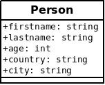
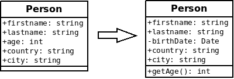
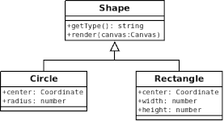
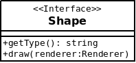
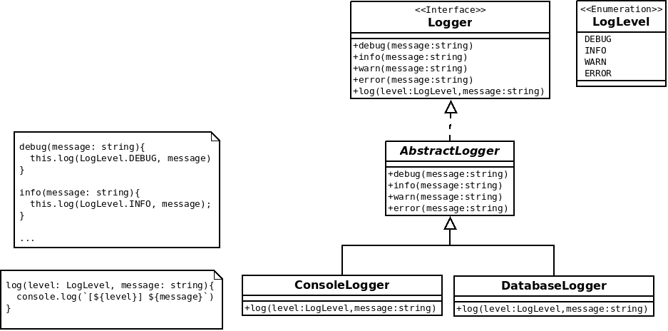

<!-- _class: titre -->
<!-- _paginate: skip -->
<!-- _footer: "" -->

###### Les patrons de conception

# **Méditation**

## Comprendre l'intérêt des différents concepts de la P.O.O.

---

<!-- _class: aside -->

> [← Retour au cours](index.md#les-bases-de-la-poo)

## Quelques exemples à méditer

- Intérêt des classes et des attributs
- Intérêt des constructeurs
- Intérêt de l'encapsulation
- Mise en garde sur l'encapsulation
- Intérêt du polymorphisme
- Intérêt des interfaces
- Mise en garde sur les interfaces
- Intérêt des classes abstraites

---

<!-- _class: colonnes dense -->

## Intérêt des classes et des attributs (1/2)

Il faut d'abord comprendre l'intérêt de pouvoir définir un type utilisateur (ex : `struct` en C). Prenons le cas d'une fonction qui teste si deux intervalles s'intersectent :

<div class="col">

Sans :

```c
bool intersects(
    double x1, double y1,
    double x2, double y2
){
    //
}
```

</div>
<div class="col">

Avec :

```c
struct Interval {
    double lower ;
    double upper ;
}

bool intersects(Interval a, Interval b){
    //
}
```

</div>

Quel est l'apport de la deuxième approche en matière d'**abstraction**, de **capacité à nommer les concepts** ?

---

<!-- _class: colonnes dense -->

## Intérêt des classes et des attributs (2/2)

Prenons un autre cas d'école où un utilitaire produit une chaîne de caractères sous la forme `"[x,y]"` :

<div class="col">

Sans :

```c
string to_json(
    double x,
    double y
) {
    //...
}
```

</div>
<div class="col">

Avec :

```c
struct Coordinate {
    double x ;
    double y ;
}

string to_json(Coordinate coordinate){
    //...
}
```

</div>

Si nous ajoutons un Z optionnel, **combien d'appels faudra-t-il modifier** pour traiter les cas 2D et 3D de manière transparente ?

---

<!-- _class: colonnes -->

## Intérêt des constructeurs (1/2)

Il faut s'intéresser à la **sécurisation de l'initialisation des objets**.

<div class="col">

Sans :

```c
Coordinate c ;
c.x = 3.0;
c.y = 4.0;
```

</div>
<div class="col">

Avec :

```java
Coordinate c = new Coordinate(3.0,4.0) ;
```

</div>

Quel est l'apport de la deuxième approche :

- Pour **éviter les erreurs de codage** (ex : oubli d'affectation du « y ») ?
- Pour **permettre l'ajout d'une propriété optionnelle** (ex : un « z » défini à `NaN` en 2D) ?

---

## Intérêt des constructeurs (2/2)

En l'absence du concept de constructeur, nous pouvons bien sûr définir une fonction utilitaire :

```c
Coordinate create_coordinate(double x, double y){
    Coordinate c ;
    c.x = x;
    c.y = y;
    return c;
}
```

Le **concept de constructeur impose tout simplement l'utilisation de cette fonction d'initialisation** aux utilisateurs du type `Coordinate`.

---

<!-- _class: colonnes dense -->

## Intérêt de l'encapsulation (1/3)

Avec une classe représentant une personne modélisée comme suit, nous pouvons **nous demander à quoi bon définir des attributs privés** :

<div class="col center">



<span class="legende">[github.com - Asabeneh/30-Days-Of-Python - Class Constructor](https://github.com/Asabeneh/30-Days-Of-Python/blob/master/21_Day_Classes_and_objects/21_classes_and_objects.md#class-constructor)</span>

</div>
<div class="col">

Après tout :

- Il est plus simple d'appeler partout `user.age` plutôt que `user.getAge()`
- Certains langages tels Python ne proposent pas le mot clé `private`

Pour comprendre l'intérêt de ce mot clé, imaginons que nous stockons des personnes ainsi modélisées dans des fichiers… et que nous laissons passer un an.

</div>

---

<!-- _class: colonnes dense -->

## Intérêt de l'encapsulation (2/3)

Après un an, nous aurons envie de **changer la modélisation** pour stocker la date de naissance (invariant temporel) et calculer l'âge à partir de celle-ci.

<div class="col center">



</div>
<div class="col">

**Permettre l'accès aux données uniquement via une indirection** (ex : `person.getAge()`), c'est **se donner la possibilité de modifier une classe sans casser le code client** (ex : `person.age >= 18`).

</div>

> En Python, il serait possible d'implémenter [`__getattr__`](https://docs.python.org/3/reference/datamodel.html#object.__getattr__) ou d'utiliser le décorateur [@property](https://docs.python.org/3/library/functions.html#property) pour éviter un changement cassant.

---

## Intérêt de l'encapsulation (3/3)

Si vous vous imaginez qu'il est si rare que ça de devoir revoir sa copie, notez que :

- Nous sommes sur un cas très simple ! Vous pouvez imaginer :
  - Devoir remplacer l'envoi de mail par un autre mécanisme de notification (ex : SMS)
  - Devoir remplacer PostgreSQL par MongoDB pour le stockage des données
- Il reste une erreur de modélisation sur la classe précédente… Vous l'avez ?

---

## Mise en garde sur l'encapsulation

Les **accesseurs et mécanismes de visibilité** donneront la **liberté de modifier l'implémentation des classes**. En limitant la surface d'exposition, nous limiterons le risque de changement cassant.

Toutefois, **il ne suffit pas de mettre mécaniquement des « getters » et « setters » sur tous les attributs** : **certains accesseurs exposeront trop d'informations sur la structure interne**.

Il sera plutôt question d'**exposer uniquement ce qui doit l'être**. En outre, **l'encapsulation pourra prendre différentes formes** selon le langage (ex : une fonction non exposée à l'aide de `export` en TypeScript).

---

<!-- _class: colonnes dense -->

## Intérêt du polymorphisme

Quel est l'intérêt de l'utilisation d'une méthode abstraite `render` dans la hiérarchie suivante ?

<div class="col center">



</div>
<div class="col">

Quel est l'**apport du polymorphisme par rapport à la conditionnelle** ci-après ?

```js
function render(canvas: Canvas, shape: Shape){
  if ( shape instanceof Circle ){
    // dessin d'un cercle
  }else if ( shape instanceof Rectangle ){
    // dessin d'un rectangle
  }else{
    throw new TypeNotSupportedError(shape);
  }
}
```

</div>

---

<!-- _class: colonnes dense -->

## Intérêt des interfaces

Le **concept d'interface** permet de **définir le contrat qui sera respecté par les classes dérivées**.

<div class="col center">

Avec Java ou PHP, il sera uniquement possible de **définir la liste des méthodes supportées** :



</div>
<div class="col">

Avec TypeScript, nous pourrons aussi spécifier des attributs :

```ts
interface Shape {
    readonly type: string;
    draw(canvas: Canvas): void;
}
```

</div>

---

## Mise en garde sur les interfaces (1/2)

**Il ne suffira pas de définir aveuglément des interfaces** pour avoir de la souplesse sur l'implémentation :

- Concevoir une interface revient à faire des choix
- Ces choix peuvent impacter les performances
- L'implémentation de certaines interfaces est plus complexe que d'autres

→ Il faudra bien **réfléchir aux implications des choix effectués dans la conception de l'interface**.

---

## Mise en garde sur les interfaces (2/2)

Par exemple, en renvoyant un tableau, nous imposerons le chargement en RAM :

```ts
interface Database {
    query(String sql, String[] params): Row[];
}
```

Nous verrons qu'il sera souvent pertinent de **permettre seulement l'itération sur les résultats** pour les données volumineuses.

---

## Intérêt des classes abstraites

Certains langages (Java, PHP, TypeScript…) permettent de définir des **classes abstraites** où **certaines méthodes sont déclarées sans être implémentées**. Elles serviront principalement à **mettre en facteur l'implémentation commune à plusieurs classes concrètes** :

<div class="center">
    
    <span class="legende">Une interface / une classe abstraite pour l'implémentation commune / les classes concrètes</span>
</div>

---

<!-- _class: fin -->
<!-- _paginate: skip -->
<!-- _footer: "" -->

# **Retour au cours**

[Les patrons de conception](index.md#les-bases-de-la-poo)
